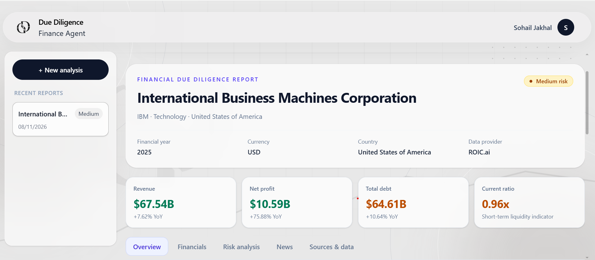
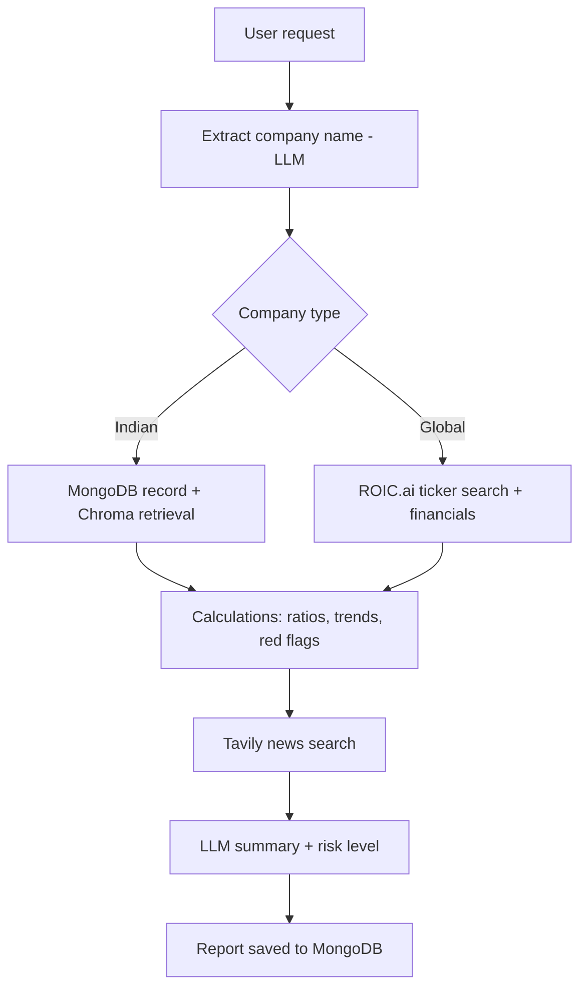

# Due Diligence Finance Agent

An AI agent that runs financial due diligence on a company from a plain-English request. Type something like *"How well does TCS cover its interest payments?"* and the agent finds the company, pulls its financials, computes key ratios and red flags in code, adds recent news context, and returns a structured report with a risk level.



## Features

- **Natural-language input.** The LLM extracts the company name and writes the final summary. Everything in between is plain code.
- **Two data paths.** 20 seeded Indian companies (MongoDB + RAG over Chroma) and global companies (ROIC.ai).
- **Numbers computed in code, not by the LLM.** Ratios, year-over-year trends and red flags come from plain JavaScript. The LLM only writes the summary and risk level from those results.
- **Red flag detection** with null-safe checks. Industrial-only checks are skipped for financial-sector companies.
- **News context** from Tavily, kept separate from financial figures.
- **Background jobs with live progress.** Analyses run in a BullMQ worker and the UI polls the job status.
- **Report dashboard** with tabs: Overview, Financials, Risk analysis, News, Sources & data.
- **Google sign-in** and a per-user history of past reports.

## How it works



The pipeline is a LangGraph.js graph. Job status moves through `queued`, `understanding_request`, `fetching_data`, `processing_data`, `calculating`, `generating_report`, then `completed` or `failed`. MongoDB stores both the job and the final report, so no LangGraph checkpointer is needed.

## Tech stack

| Layer | Tools |
|---|---|
| Frontend | React, Vite, Tailwind CSS, React Router, Motion |
| Backend | Node.js, Express, Passport (Google OAuth), express-session |
| Orchestration | LangChain, LangGraph.js |
| Queue and cache | BullMQ, Redis (Redis Cloud) |
| Database | MongoDB |
| Vector store | Chroma Cloud, Cohere embeddings (`embed-v4.0`) |
| LLM | Groq (`openai/gpt-oss-120b`) |
| Data sources | ROIC.ai (global financials), Tavily (news), seeded Indian company dataset |
| Infra | Docker Compose (API and worker) |

## API

| Method | Endpoint | Description |
|---|---|---|
| POST | `/api/analyze` | Create an analysis job from a text request. Returns `jobId`. |
| GET | `/api/status/:jobId` | Current job status. |
| GET | `/api/report/:jobId` | Final report once the job is completed. |
| GET | `/api/history` | The signed-in user's recent reports. |
| GET | `/auth/me` | Current user. |
| POST | `/auth/logout` | Sign out. |

All `/api` routes are scoped to the signed-in user.

## Getting started

### Prerequisites

- Node.js 20 or newer
- Docker and Docker Compose (optional, for running the API and worker)
- Accounts and keys for: MongoDB, Redis Cloud, Google OAuth, Groq, Cohere, Chroma Cloud, Tavily, ROIC.ai

### Setup

1. Clone the repo and install dependencies.

   ```bash
   git clone https://github.com/Sohail98125/Due-Diligence-Finance-Agent.git
   cd Due-Diligence-Finance-Agent
   cd backend && npm install
   cd ../frontend && npm install
   ```

2. Create the backend environment file.

   ```bash
   cp backend/.env.example backend/.env
   ```

   Fill in every value in `backend/.env`. Never commit this file.

3. Redis eviction policy: set the Redis Cloud database's data eviction policy to `noeviction`, which BullMQ requires.

### Run with Docker

```bash
docker compose up --build
```

This starts the API on port 5000 and the BullMQ worker as a separate process.

### Run without Docker

```bash
# terminal 1
cd backend && npm run dev

# terminal 2
cd backend && npm run worker

# terminal 3
cd frontend && npm run dev
```

The frontend runs on `http://localhost:5173` and the API on `http://localhost:5000`.

## Known limitations

- The Indian dataset covers 20 companies, FY2021-22 to FY2024-25.
- ROIC.ai's free tier is limited to 5 requests per minute, so analyses of new global companies can fail under heavy use. Results are cached in Redis for 24 hours.
- News is used for qualitative context only. Financial figures always come from the financial data providers.

## Disclaimer

Reports support financial review. They are not investment advice.